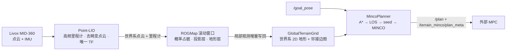
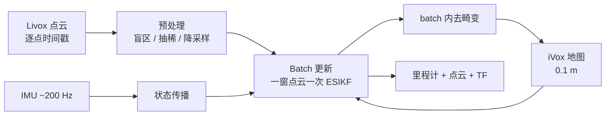
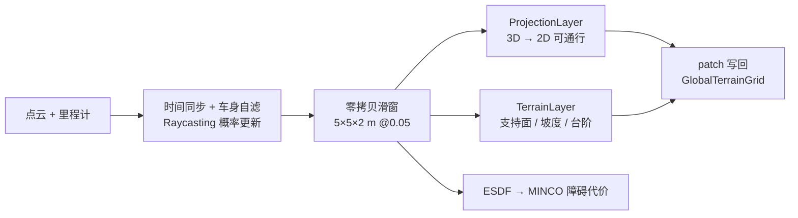
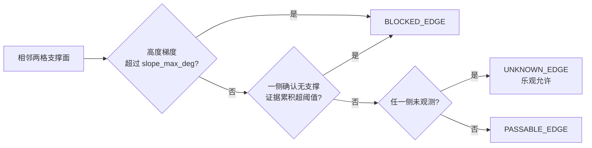
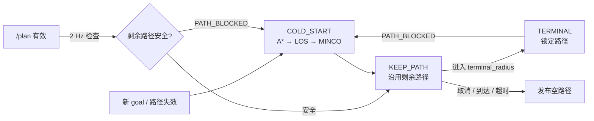

<div align="center">

# TEMPO

### **T**errain-**E**vidence **M**apping and **P**ath **O**ptimization

### 面向全向轮式底盘的在线地形证据建图与 MINCO 路径优化

**Livox MID-360 · Point-LIO · ROGMap · GlobalTerrainGrid · A\*/LOS · MINCO · ROS 2 Humble**

</div>

---

TEMPO 在一台 Livox MID-360 上完成「定位 → 局部占据 → 世界系地形 → 路径优化」的在线闭环，持续向外部 MPC 输出可执行路径。系统不使用先验地图，不做重定位与跨运行地图恢复。

## 1. 整体链路



整条链路只有一个 TF 发布者（Point-LIO）：世界系 `camera_init`，底盘中心 `base_link`；planner 只输出几何路径，不做速度跟踪闭环。

## 2. 快速开始

**环境**：Ubuntu + ROS 2 Humble，已安装 [Livox SDK2](https://github.com/Livox-SDK/Livox-SDK2)（驱动编译依赖）。工作区默认位于 `~/workspace/tempo_ws`。

```bash
# 1) 环境
source /opt/ros/humble/setup.bash
cd ~/workspace/tempo_ws
rosdep install -r --from-paths src --ignore-src --rosdistro humble -y

# 2) 编译（livox_ros_driver2 → point_lio → rog_map → navigation，含 rog_map 的底层依赖 grid_map_core）
bash build.sh

# 3) 启动（每个节点一个 gnome-terminal 窗口）
bash launch.sh
```

- 回放 rosbag：`USE_SIM_TIME=1 bash launch.sh`，另开终端 `ros2 bag play <bag> --clock`。
- 跨机运行 MPC：`ROS_LOCALHOST_ONLY=0 bash launch.sh`。
- 下发目标：向 `/goal_pose` 发布 `geometry_msgs/PoseStamped`；同步 `ComputePathToPose` action 不返回执行路径。
- `launch.sh` 中雷达驱动窗口默认注释，驱动已在别处运行时无需打开。

## 3. 参数配置入口

| 配置文件 | 负责范围 |
| --- | --- |
| `src/livox_ros_driver2/config/MID360_config.json` | 雷达网络：IP、端口、主机与雷达绑定 |
| `src/livox_ros_driver2/config/MID360_params.yaml` | 驱动输出：发布格式、频率、frame、点云字段 |
| `src/point_lio/config/mapping/mid360.yaml` | Point-LIO：雷达—IMU 与雷达—底盘外参、滤波与 batch 更新、TF 与 frame 命名（**外参唯一来源**） |
| `src/navigation/params/online_planner.yaml` | 在线 ROGMap、投影层与地形层、全局地形图、A\*/LOS/MINCO、平面动力学、路径生命周期 |
| `src/navigation/launch/online_navigation.launch.py` | 节点编排：参数注入、frame 一致性校验 |
| `src/navigation/config/online_navigation.rviz` | RViz 默认视图 |

## 4. 技术路线

### 4.1 高频激光惯性里程计（Point-LIO）



毫秒级 batch 更新把一窗点云的观测方程拼成一次滤波迭代，`batch.omp` 只并行 KNN 与平面拟合，滤波数学保持串行；batch 频率的 posterior 直接驱动高频里程计。

### 4.2 滚动占据与地形层（ROGMap）



障碍清除只有一个来源：后续 ray miss 或再次确认为 free；没有新观测不会清障，也不做全图 flood fill。

### 4.3 世界系地形图与邻接边状态（GlobalTerrainGrid）

滚动窗口只负责机器人附近的观测，planner 统一查询世界系固定的二维地形图；历史区域不随机器人移动消失，但仍可被新观测修正。相邻支撑格的高度关系决定边状态（`slope_max_deg=35°`）：



搜索、简化、优化、校验共用同一套查询语义：

| 查询 | 语义 |
| --- | --- |
| `cellTraversable(mx,my)` | UNKNOWN / FREE → true，OCCUPIED → false |
| `edgeAllowed(a,b)` | UNKNOWN_EDGE / PASSABLE_EDGE → true，BLOCKED_EDGE → false |
| `footprintFree(pos)` | 足印圆内同时检查障碍格与 BLOCKED 边 |

> 当前 `global_map.void_gain=0.0`，即「一侧确认无支撑」的多帧证据链关闭；`global_map.enable=false` 可一键回退到旧的滚动局部图行为。

### 4.4 规划主链（A\* → LOS → seed → MINCO）


A\* 只做 ROI 窗口内的势场传播：全局图格数很大，整图传播会阻塞 executor 并被 Nav2 生命周期心跳判死。输出按**弧长**而非时间采样——按时间采样会让慢速段过密、高速段过稀。

### 4.5 路径生命周期（复用 / 重规划 / 撤销）



同一 goal 且上一条轨迹仍可用时走条件式热启动（`warm_start_enable`），把剩余段作为 MINCO 初值；`/plan` 与 `/terrain_minco/plan_meta` 均为 reliable、volatile、depth 10，按完整 header 配对。里程计超过 `external_odom_timeout=0.5 s` 或地图超过 `external_map_timeout=1.0 s` 未更新即撤销路径。

## 5. 目录架构

```text
tempo_ws/
├── build.sh                         # colcon 构建（Release，--packages-up-to navigation）
├── launch.sh                        # 分窗口启动整条链路
└── src/
    ├── livox_ros_driver2/           # MID-360 点云 + IMU 驱动
    ├── point_lio/                   # 高频激光惯性里程计、去畸变世界系点云、唯一 TF
    ├── rog_map/                     # 滚动概率占据、投影层、地形层、GlobalTerrainGrid、ESDF
    │   ├── include/rog_map/         # 地图核心与统一查询接口
    │   └── src/rog_map/             # 增量更新、距离场、地形图实现
    ├── navigation/                  # Nav2 MincoPlanner 插件与在线规划
    │   ├── src/minco_core/          # A*、走廊、安全检查、FSM、可视化
    │   ├── src/traj_opt/            # MINCO 轨迹优化
    │   ├── params/ online_planner.yaml
    │   ├── launch/ online_navigation.launch.py
    │   └── msg/                     # PlanMeta 等外部接口消息
    └── grid_map/                    # vendored 子集：grid_map_core（rog_map 的底层依赖）+ CMake helpers
```

## 6. Reference

**上游算法与工程**

- Point-LIO — [hku-mars/Point-LIO](https://github.com/hku-mars/Point-LIO)：高频激光惯性里程计（iVox + IEKF）。
- ROG-Map — [hku-mars/ROG-Map](https://github.com/hku-mars/ROG-Map)，[arXiv:2302.14819](https://arxiv.org/abs/2302.14819)：面向大场景的滚动占据栅格建图。
- MINCO / GCOPTER — [ZJU-FAST-Lab/GCOPTER](https://github.com/ZJU-FAST-Lab/GCOPTER)，[arXiv:2103.00190](https://arxiv.org/abs/2103.00190)：几何约束下的多项式轨迹优化。
- Livox ROS Driver 2 — [Livox-SDK/livox_ros_driver2](https://github.com/Livox-SDK/livox_ros_driver2)。
- Nav2 — [ros-navigation/navigation2](https://github.com/ros-navigation/navigation2)：planner 生命周期与插件宿主。
- grid_map — [ANYbotics/grid_map](https://github.com/ANYbotics/grid_map)（`origin/humble` 分支子集）。

