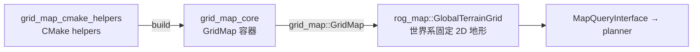
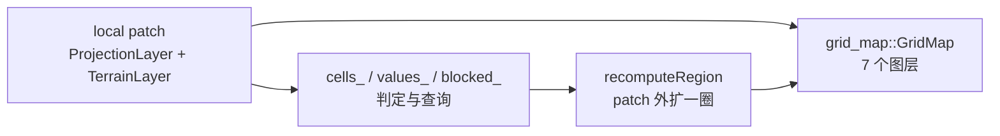

`grid_map` 是从 [ANYbotics/grid_map](https://github.com/ANYbotics/grid_map)（`origin/humble`）抽取的 **vendored 子集**：只保留 `grid_map_cmake_helpers` 与 `grid_map_core` 两个包，作为 `rog_map` 的底层容器依赖，不参与算法语义。

## 1. 在链路中的位置



- `grid_map_core` 只依赖 `eigen`（`grid_map_cmake_helpers` 仅是 build 期的 CMake 支持），**不依赖 ROS，也不依赖 rog_map**——依赖方向严格单向。
- 本仓库只用到 `GridMap` 的二维多图层容器能力；ROS 消息、`grid_map_ros`、过滤器、RViz 插件、`grid_map_msgs` 等上游包都没有接入，`grid_map_msgs` 已删除。
- 上游 README 提到的 `grid_map_ros` / `grid_map_filters` / `grid_map_msgs` / `grid_map_demos` 等**不在本仓库**。

## 2. 启动与检查

没有独立节点、launch 或可执行文件；它随 `rog_map` 一起被编译进主链路：

```bash
bash build.sh                                     # 构建顺序：grid_map_cmake_helpers → grid_map_core → rog_map → navigation
ros2 pkg prefix grid_map_core
```

## 3. 参数配置入口

本包自身**没有参数文件**。真正决定 `GridMap` 几何与图层含义的参数在 `rog_map` 侧：

| 位置 | 负责范围 |
| --- | --- |
| `src/navigation/params/online_planner.yaml` → `MincoPlanner.rog_map.global_map.*` | `GlobalTerrainGrid` 的分辨率、尺寸、原点、坡度阈值、EDT 周期 |
| `src/rog_map/src/rog_map/global_terrain_grid.cpp` | 图层定义与读写 |

## 4. 技术路线

`GlobalTerrainGrid` 内持有一个 `grid_map::GridMap`，与本包自有数据结构并行维护：自有 `cells_` / `values_` / `blocked_` 负责判定与查询，`GridMap` 作为图层后端同步保存同一份结果，供按层导出使用。



| 图层 | 含义 |
| --- | --- |
| `elevation` | 支持面高度 |
| `observed` | 是否被真实测量观测过 |
| `support_confidence` | 支持面置信度 |
| `obstacle_confidence` | 障碍置信度 |
| `void_confidence` | 悬空 / 无支撑证据 |
| `traversability` | 254 障碍 / 0 已观测可通行 / 255 未知 |
| `blocked` | 邻接边是否被阻塞 |

图层只在**局部 patch 写回**时同步更新（不做全图刷新），几何变化时整体重建。

## 5. 目录架构

```text
src/grid_map/
├── grid_map_cmake_helpers/     # 两个包共用的 CMake helper
│   ├── cmake/
│   └── package.xml
├── grid_map_core/              # GridMap 容器、几何 / Polygon、各类 iterator
│   ├── include/grid_map_core/
│   ├── src/
│   ├── cmake/
│   └── package.xml             # 仅依赖 eigen + grid_map_cmake_helpers(build)
└── README.md
```

## 6. Reference

- 上游仓库 — [ANYbotics/grid_map](https://github.com/ANYbotics/grid_map)（`origin/humble` 分支子集），BSD 3-Clause。
- 引用 — P. Fankhauser and M. Hutter, *"A Universal Grid Map Library: Implementation and Use Case for Rough Terrain Navigation"*, in Robot Operating System (ROS) – The Complete Reference (Volume 1), Springer, 2016.
- [工作区主页](../../README.md)
- [rog_map/README.md](../rog_map/README.md)：本包唯一的消费者与图层用法
