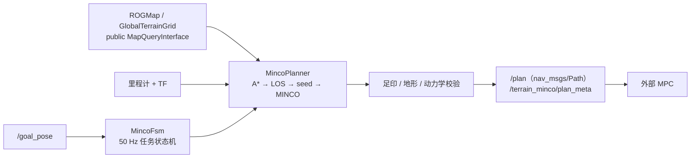
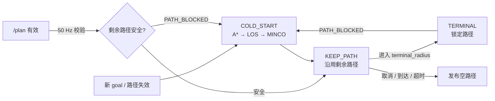

`navigation` 是在线规划包：以 Nav2 `GlobalPlanner` 插件形式接入，消费 `/goal_pose` 与在线地图，输出供外部 MPC 跟踪的几何路径。它同时包含消息定义、参数、launch 与 RViz 配置。

## 1. 在链路中的位置



- 插件名 `navigation/MincoPlanner`，由 `nav2_planner::PlannerServer` 承载，运行在 `online_navigation_container`（`MultiThreadedExecutor`，4 线程）里。
- 地图以进程内指针传入（`rog_map` 的 `MapQueryInterface`），不经过 ROS topic，也不直接访问投影层/地形层内部实现。
- planner 只输出几何路径，不做速度跟踪闭环；朝向与时序由外部 MPC 决定。

## 2. 启动与检查

```bash
bash launch.sh                                        # 或单独：
ros2 launch navigation online_navigation.launch.py rviz:=true
```

| 接口 | 方向 | 说明 |
| --- | --- | --- |
| `/goal_pose`（`geometry_msgs/PoseStamped`） | 输入 | 规划目标；同步 `ComputePathToPose` action **不返回执行路径** |
| `/planning/cancel`（`std_msgs/Bool`） | 输入 | 取消当前任务，发布空路径撤销参考 |
| `/plan`（`nav_msgs/Path`） | 输出 | 弧长均匀重采样后的路径，底盘中心 XY，`z=0` |
| `/terrain_minco/plan_meta`（`navigation/PlanMeta`） | 输出 | `path_id` / `publish_seq` / `replanned` / `path_start_s` / `reason`，与 `/plan` 按完整 header 配对 |

两个输出都用 `KeepLast(1)` + reliable + **transient_local**（latching）：迟到的 RViz/MPC 订阅者能立即拿到当前参考。注意 Nav2 `PlannerServer` 自身在 `/plan` 上还有一个默认 QoS 的 publisher，两者 durability 不同会在启动时产生一条 "incompatible QoS" 警告——只影响可视化订阅，不影响路径内容。

## 3. 参数配置入口

| 位置 | 负责范围 |
| --- | --- |
| `src/navigation/params/online_planner.yaml` → `planner_server.ros__parameters.MincoPlanner.*` | 模式、frame、在线地图与地形、A*/LOS/MINCO、动力学、路径复用与生命周期 |
| `src/navigation/params/online_planner.yaml` → `MincoPlanner.rog_map.*` | 进程内 ROGMap 与全局地形图（详见 [rog_map/README.md](../rog_map/README.md)） |
| `src/navigation/launch/online_navigation.launch.py` | 节点编排；从 `mid360.yaml` 注入外参并校验 frame 一致 |
| `src/navigation/config/online_navigation.rviz` | RViz 默认视图 |

外参只在 `point_lio/config/mapping/mid360.yaml` 维护一份，本包不重复标定。

## 4. 技术路线

### 4.1 规划主链


- A* 只做 ROI 窗口内的势场传播（`RoiQueryAdapter`）：全局图 280×480 格，整图传播会阻塞 executor 并被 Nav2 生命周期心跳判死。
- 输出按**弧长**而非时间采样（`path_geometry.output_spacing=0.05`）；中间位姿取路径切线 yaw，最后一个位姿用用户给定的目标朝向。
- `enable_yaw_opt=false`：不约束外部 MPC 的执行朝向或时序。

### 4.2 查询语义：UNKNOWN 可通行

搜索、简化、优化、校验共用同一套语义，来源只有两个函数加一个足印检查：

| 查询 | 语义 |
| --- | --- |
| `cellTraversable(mx,my)` | UNKNOWN / FREE → true，OCCUPIED → false |
| `edgeAllowed(a,b)` | UNKNOWN_EDGE / PASSABLE_EDGE → true，BLOCKED_EDGE → false |
| `footprintFree(pos)` | 足印圆内同时检查障碍格与 BLOCKED 边 |

UNKNOWN 与 FREE 同价，只有已观测到的障碍和 BLOCKED 边禁行（`allow_unknown=true`）。`start` 与 `goal` 都允许落在 UNKNOWN；goal 在观测范围外时取射线与地图边界的交点作为搜索端点，真正的 goal 位置接到路径末尾。

### 4.3 动力学：硬件上限与规划巡航速度分开

`dynamics.max_vel` 是硬件/校验硬上限，`dynamics.planning_vel` 才是 MINCO/A* 种子时间分配真正使用的巡航速度。用 10 m/s 级别的软件上限直接规划会得到 ~0.8 s 的短时轨迹，位置罚项按 `∫dt` 计权而失去作用，轨迹切角贴边并被 validator 整条拒绝。

| 参数 | 当前值 | 含义 |
| --- | ---: | --- |
| `max_vel` / `max_acc` / `max_jerk` | 10 / 3 / 10 | 校验硬上限 |
| `planning_vel` | 2.0 m/s | 实际规划巡航速度 |
| `optimizer_margin` | 0.85 | 优化器使用硬上限的比例 |
| `safe_dist` | 0.70 m | 必须 ≥ 地形硬净空 0.626 m，否则 MINCO 会吐出被 validator 整条拒绝的贴边轨迹 |
| `lookahead_dist` | 4.0 m | 局部路径前视长度 |

### 4.4 路径生命周期



- 安全校验（`safetyTimer`）与 FSM 都是 **50 Hz**，只做「校验剩余路径 / 读标志」；完整 A*→LOS→MINCO 只在真正 `PATH_BLOCKED` 时执行一次。
- `better_path` 默认关闭（`better_path_enable: false`），`nominal_replan_hz=2.0` 只用于"路径仍然可走时是否再看一眼更优解"。
- 同一 goal 且上一条轨迹仍可用时走条件式热启动（`warm_start_enable`）；`PATH_BLOCKED` / 新 goal / 旧轨迹失效时强制 COLD_START。
- 里程计超过 `external_odom_timeout=0.5 s` 或地图超过 `external_map_timeout=1.0 s` 未更新即撤销路径。
- 路径校验只看**剩余路径**（带 `lookback_margin` 回看），不重查已走过的历史段。

### 4.5 全局代价地图只是占位

`global_costmap` 只挂一个被禁用的 inflation 层：净空、地形与碰撞全部由 ROGMap / `GlobalTerrainGrid` 的足印检查负责，避免两套膨胀叠加。

## 5. 目录架构

```text
src/navigation/
├── src/minco_core/          # 插件入口、FSM、A*、走廊、安全检查、可视化
│   └── components/          # 全局搜索、路径处理、地图查询适配、模式上下文
├── src/traj_opt/            # MINCO 曲线优化
├── src/utils/               # 优化与几何基础件（lbfgs / sdlp / mvie / banded_system ...）
├── include/minco_core/      # 插件、FSM 与组件头文件
├── include/traj_opt/        # MINCO 头文件
├── include/utils/           # 优化、几何与通用头文件
├── include/data_structure/  # 轨迹/片段/椭球基础类型
├── launch/online_navigation.launch.py
├── params/online_planner.yaml
├── config/online_navigation.rviz
├── msg/PlanMeta.msg
└── test/                    # trajectory_dynamics_test / plan_reuse_test
```

共享库 `libminco_planner.so` 承载算法与插件，ROS 外壳是可执行的 `online_navigation_container`。消息只有 `PlanMeta`（`/plan` 配套元数据）。

## 6. Reference

**上游算法与工程**

- MINCO / GCOPTER — [ZJU-FAST-Lab/GCOPTER](https://github.com/ZJU-FAST-Lab/GCOPTER)，[arXiv:2103.00190](https://arxiv.org/abs/2103.00190)：几何约束下的多项式轨迹优化。
- Nav2 — [ros-navigation/navigation2](https://github.com/ros-navigation/navigation2)：planner 生命周期与插件宿主。

**仓库内文档**

- [工作区主页](../../README.md)
- [rog_map/README.md](../rog_map/README.md)：地图与全局地形图的产出与查询语义
- [point_lio/README.md](../point_lio/README.md)：里程计、点云与 TF
