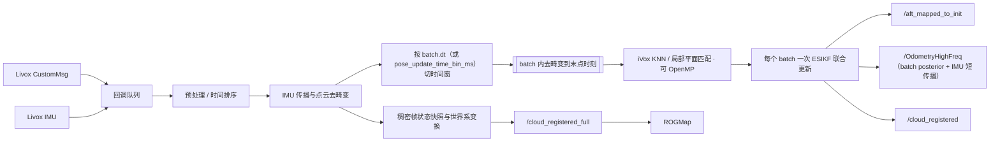

> 当前实车链路统一由 `ros2 launch navigation online_navigation.launch.py` 启动，唯一在线配置在 [config/mapping/mid360.yaml](config/mapping/mid360.yaml)。已移除先验 PCD 加载和指定初始位姿分支，地图由本次观测初始化并持续更新。完整 pipeline 见 [工作区说明](../../README.md)。

# 🛰️ Point-LIO ROS 2

> 面向单 Livox MID-360 实车导航的高频激光惯性里程计组件，提供去畸变定位、稠密世界系点云和低开销进程内感知链路。

[返回项目主页](../README.md) · [Livox Driver](../README.md) · [ROGMap](../rog_map/README.md)

## ✨ 本仓库版本亮点

- ROS 2 Component 化，可与 Livox Driver、Planner/ROGMap 部署在同一多线程容器。
- `CustomMsg::UniquePtr` 输入与 `PointCloud2::UniquePtr` 输出，为进程内零拷贝/少拷贝提供必要条件。
- 原始点云、滤波定位点云与 `/cloud_registered_full` 稠密点云职责分离。
- 稠密点云按点时间稳定排序，结合状态快照进行去畸变并变换到世界系。
- “最新完整帧”发布采用 SensorData QoS `keep_last(1)`，减少旧大消息排队。
- 公开里程计使用底盘中心，支持完整安装旋转和平移，以及速度杆臂补偿。
- 增加 `blind_center`，可将近场盲区中心对齐到实际底盘中心。
- 独立工作线程分离 ROS 回调与主 LIO 处理，降低高频调度互相阻塞。
- **Batch-LIO 式毫秒级批量更新**（`mapping.batch.*`）：按点采样时间切 `batch.dt` 时间窗，一个 batch 只做一次 ESIKF 联合更新；`dt<=0` 可回退逐点路径。
- **batch 内去畸变**：以 batch 末点时刻为参考，用当前 posterior 的角速度/世界速度把组内点补偿到末端，并同步重建 Jacobian 缓存。
- **batch 内 KNN/平面拟合 OpenMP 并行**（`batch.omp`），H/z 组装与滤波数学保持串行不变。
- **batch 频率的高频 posterior 源**：`/OdometryHighFreq` 由最新 batch 校正状态驱动，而不是整帧末状态。
- 驱动与估计器**彻底解耦**：point_lio 的任何 launch 入口都不再拉起雷达驱动，`livox_ros_driver2` 只作为 `CustomMsg` 的编译依赖。

> `UniquePtr + intra-process` 能显著减少同进程消息拷贝，但是否达到完全零拷贝还取决于 ROS 2 中间件、发布/订阅类型和容器部署方式。

## 🔄 模块流程图



### 流程概述

LiDAR/IMU 回调先写入 pending 队列，mapping worker 完成同步、预处理与去畸变。定位点云经体素降采样并按点时间排序后，用 `batch.dt`（batch 模式）或 `pose_update_time_bin_ms`（原路径）切成时间窗；每个 batch 先传播到**组末点时刻**，再把组内点补偿到该时刻，然后以组内全部点执行 iVox 最近邻搜索、局部平面匹配和**一次** ESIKF 联合更新。成功状态按传感器时间限频发布 odom/TF；batch 模式下每个 batch 的 posterior 还会刷新 `/OdometryHighFreq` 的数据源。完整点云链路独立保留预处理有效点，通过状态快照分段补偿后发布给 ROGMap，不因定位 batch 合并而删点。

## 🧪 技术方向

- 以 IMU 传播和点到局部平面残差完成高频激光惯性状态估计。
- `mapping.batch.*` 提供 Batch-LIO 式时间窗更新：`batch.dt` 定窗宽，`batch.deskew` 决定是否把组内点补偿到末点时刻，`batch.omp` 决定 KNN/平面拟合是否 OpenMP 并行；`batch.enable=false` 时完全走原 `pose_update_time_bin_ms` 路径。
- 每个 batch 仍遍历该组全部定位点，调用 iVox KNN 并构造有效平面约束；batch 改变的是状态更新粒度，不是简单丢点。一个 batch 内所有点联合构造 H/z，只做一次 IEKF 更新。
- odom 只在成功状态更新后按传感器时间限频发布；当前配置目标为 `200 Hz`。`/OdometryHighFreq` 由 `ImuOdometryPredictor` 在每个 IMU 样本上输出，并以 `max_correction_age_sec` 做失效保护。
- `/cloud_registered_full` 使用独立状态快照完成完整点云去畸变和世界系变换，为地图保留更充分的观测。

## ⚡ 性能方向

- Livox driver 与 Point-LIO 部署在同一 `component_container_mt`，点云输入采用 `CustomMsg::UniquePtr`，降低大消息序列化和复制。
- `/cloud_registered_full` 使用 `PointCloud2::UniquePtr` 移动发布和 `SensorDataQoS().keep_last(1)`，下游过载时优先丢旧帧。
- 定位点云可降采样，完整地图点云单独发布；避免为了地图密度让所有原始点进入滤波更新。
- 时间窗 batch 减少 ESIKF 更新次数和状态发布调度，但 iVox 最近邻搜索仍按 batch 内点执行；`batch.omp=true` 时该部分按点并行。
- **`batch.omp=true` 必须配 `OMP_WAIT_POLICY=PASSIVE`**：OpenMP 默认 ACTIVE 自旋会让工作线程在并行区之间空转、与跟踪线程抢核，实测受限核数下实时率从 `1.00` 掉到 `0.31`；两个 launch 入口都已通过 `additional_env` 强制 PASSIVE（调用方已设则不覆盖），`launch.sh` 也导出该变量。节点在检测到非 PASSIVE 时会打印告警。
- `RuntimeStatistics` 总开关控制 IMU、状态、逐帧性能 CSV 和低频摘要；关闭时不创建日志文件，也不执行新增阶段计时。

## 📡 ROS 接口

### 输入

| Topic | 类型 | 说明 |
|---|---|---|
| `livox/lidar` | `livox_ros_driver2/msg/CustomMsg` | 单雷达或驱动层融合后的点云 |
| `/livox/imu` | `sensor_msgs/msg/Imu` | 当前单雷达 IMU |

### 输出

| Topic | Frame | 说明 |
|---|---|---|
| `/aft_mapped_to_init` | `camera_init` → `base_link` | 底盘中心位姿；twist 在 base_link 中。batch 模式下每个 batch 更新后按传感器时间限频发布 |
| `/OdometryHighFreq` | `camera_init` → `base_link_hf` | 高频底盘中心 pose/velocity；由最新 LiDAR 校正 posterior 播种 + IMU 短传播，`correction_age` 超限时 withhold |
| `/point_lio/odometry_scan` | `camera_init` → `base_link` | 每次整帧校正后的状态快照，便于对照高频输出 |
| `/cloud_registered` | `camera_init` | 定位/可视化注册点云 |
| `/cloud_registered_full` | `camera_init` | 稠密、去畸变、世界系完整帧，ROGMap 主输入 |
| `/cloud_registered_body` | `imu_link` | IMU 系注册点云（默认关闭） |
| `/Laser_map` | `camera_init` | 累积地图 |
| `/path` | `camera_init` | 里程计路径 |

Point-LIO 直接发布 `camera_init → base_link` 动态 TF，以及 `base_link → livox_frame → imu_link` 静态 TF。内部 EKF、协方差和 iVox 地图始终留在 IMU 初始化得到的世界系 `W`，全程不再重写；公开里程计和 `/path` 使用底盘中心，固定外参的逆变换和组合变换只在初始化时计算一次。

**输出零点延迟冻结。** IMU 初始化只靠重力方向定姿态（`Quaterniond::FromTwoVectors`），yaw 是任意的，此时冻结零点会把没收敛的偏置写进所有对外输出（实测同一次静止启动在不同雷达频率下的起始 yaw 能差 8°、平移差 0.35 m）。因此 `zero_at_start` 改为：等 LiDAR IEKF 跑够 `zero_delay_sec` 后再记录 `T_WB0`，之后所有世界系输出统一用

```
T_OB(t) = (T_WB0)^-1 * T_WB(t)
```

`/aft_mapped_to_init`、`/OdometryHighFreq`、`/point_lio/odometry_scan`、`camera_init → base_link(_hf)` TF、`/cloud_registered`、`/cloud_registered_full`、`/path` 走的是同一个 `T_OB`，保证 odom 与点云同系。冻结之前这些话题一律不发布（对外相当于 odom 无效），避免出现一次性跳变。

## ⚙️ 关键配置

主配置：[config/mapping/mid360.yaml](config/mapping/mid360.yaml)。雷达网络和驱动参数属于 `livox_ros_driver2/config/`；本包只保存 LIO 参数。

### 输入与 IMU

```yaml
common:
  lid_topic: "livox/lidar"
  imu_topic: "/livox/imu"
  use_imu_as_input: false
  prop_at_freq_of_imu: true
```

当前驱动为单雷达共享话题模式，IMU 输入固定为 `/livox/imu`。

### 🎯 Blind 中心

```yaml
preprocess:
  blind: 0.35
  blind_center_enable: true
  blind_center: [0.0, 0.20, 0.0]
```

传统盲区以雷达原点为中心。本项目允许把盲区中心平移到底盘中心附近，避免安装偏置导致车体近场点在不同方向被不一致地保留。`blind_center` 是预处理距离判断中心，不是 TF，也不会替代正确外参。

### 📐 传感器与底盘外参

唯一配置入口为 `config/mapping/mid360.yaml`。约定 `T_B^A` 将 B 系坐标转换到 A 系，与 fastlio_nav2 一致：

```yaml
sensor_extrinsic:
    imu_in_lidar_R: [1.0, 0.0, 0.0,
                     0.0, 1.0, 0.0,
                     0.0, 0.0, 1.0]
    imu_in_lidar_T: [0.011, 0.02329, -0.04412]
robot_extrinsic:
    lidar_to_robot_R: [1.0, 0.0, 0.0,
                       0.0, 1.0, 0.0,
                       0.0, 0.0, 1.0]
    lidar_to_robot_T: [-0.1025, -0.303, 0.2634]
```

`sensor_extrinsic` 配置 **IMU → LiDAR**，即 `p_lidar = R * p_imu + T`；Point-LIO 内部初始化其逆变换 `Rᵀ, -RᵀT`，配置的平移不取反。`robot_extrinsic` 配置 **LiDAR → 底盘中心**，即 `p_robot = R * p_lidar + T`。平移单位 m，矩阵按行排列，启动时校验有限性、正交性与行列式。

两组外参组合得到 IMU 在底盘中的位姿，再由当前 IMU 状态得到底盘位姿。线速度包含 `ω × 杆臂` 修正，并和角速度一起转换到 base_link。固定外参链使用 `mapping.extrinsic_est_en: false`；该实车链路拒绝在线改变雷达—IMU 外参，外参修改后重启。

完整世界系点云的计算保持一致，导航 launch 从同一配置提取雷达安装位置供 ROGMap 射线起点使用，不在导航 YAML 重复维护外参。

### 发布与地图

| 参数 | 作用 |
|---|---|
| `publish.tf_send_en` | 发布 LIO TF |
| `publish.scan_publish_en` | 发布注册点云 |
| `publish.dense_publish_en` | 保留更稠密的输出 |
| `publish.scan_bodyframe_pub_en` | 发布机体系点云 |
| `publish_accumulated_map` | 发布累积地图 |
| `publish.accumulated_map_publish_hz` | 限制大地图发布频率 |
| `pcd_save.pcd_save_en` | 保存 PCD；会产生磁盘开销 |

### Batch、iVox 与 odom

| 参数 | 当前配置 | 作用 |
|---|---:|---|
| `mapping.batch.enable` | `true` | batch 模式总开关；`false` 时完全走原 `pose_update_time_bin_ms` 路径，便于 A/B 对照 |
| `mapping.batch.dt` | `0.001` s | batch 时间窗；按每点采样时间切 `[t0, t0+dt)`。`<=0` 回退逐时间戳（逐点）更新 |
| `mapping.batch.deskew` | `true` | batch 内把每个点按当前 posterior 补偿到 batch 末点时刻；仅 `use_imu_as_input=false` 分支实现 |
| `mapping.batch.omp` | `true` | batch 内 KNN/平面拟合 OpenMP 并行；**需配 `OMP_WAIT_POLICY=PASSIVE`** |
| `mapping.pose_update_time_bin_ms` | `2.0` ms | 原路径的时间 batch；`batch.enable=true` 时被忽略并打印告警 |
| `mapping.ivox_grid_resolution` | `2.0` m | iVox 体素尺度，直接影响单体素点密度和邻域搜索 |
| `filter_size_map` | `0.1` m | 地图代表点分辨率；iVox 每个该尺度子栅格只保留一个靠近中心的代表点 |
| `ivox_nearby_type` | `6` | 搜索中心体素及 6 邻域；可选 0/6/18/26 |
| `odometry.zero_at_start` | `true` | 是否冻结输出零点；`false` 时直接用 IMU 初始化世界系，不做输出变换 |
| `odometry.zero_delay_sec` | `1.5` s | 首次 LiDAR 校正后再等这么久才冻结零点 |
| `odometry.publish_frequency_hz` | `200` Hz | 成功状态更新上的传感器时间发布限频 |
| `odometry.high_frequency_enable` | `true` | 是否发布 `/OdometryHighFreq` |
| `odometry.max_correction_age_sec` | `0.3` s | LiDAR 校正落后 IMU 超过该值时不发布高频状态（失效保护） |
| `runtime_pos_log_enable` | `false` | 全部运行时日志、CSV 和统计摘要总开关 |
| `runtime_log_path` | 空 | 空值写入 `ROOT_DIR/Log`，也可配置绝对/相对路径 |

## 🚀 推荐启动

point_lio 的 launch 入口**只起估计器**，不含、也不会拉起雷达驱动 —— 驱动必须单独启动：

```bash
# 1) 单独启动雷达驱动（另开一个终端）
ros2 launch livox_ros_driver2 msg_MID360_launch.py

# 2) 启动估计器
ros2 launch point_lio mapping_mid360.launch.py            # 默认带 rviz
ros2 launch point_lio mapping_mid360.launch.py rviz:=false
```

启动日志里只有 `laserMapping`，不会出现 `livox_ros::DriverNode`。

以组件方式与其它节点共享容器的部署由 navigation 的整链路入口负责：`online_navigation.launch.py` 的 `start_pointlio:=true` 会把 `point_lio::LaserMappingNode` 装进它自己的 `component_container_mt`，point_lio 侧不再提供组合入口。

`mapping_mid360.launch.py` 和 navigation 容器都用 `additional_env` 把 `OMP_WAIT_POLICY` 固定为 `PASSIVE`（调用方已设则不覆盖），`launch.sh` 也导出同一默认值；`batch.omp=true` 时这是实时性的前提。

完整导航使用 `ros2 launch navigation online_navigation.launch.py`，无需再单独启动这个调试入口。

启动后检查：

```bash
ros2 topic hz /aft_mapped_to_init        # 目标 200 Hz
ros2 topic hz /OdometryHighFreq          # 目标 ~200 Hz；被 withhold 时无输出
ros2 topic hz /cloud_registered_full
ros2 topic info /cloud_registered_full --verbose
ros2 run tf2_ros tf2_echo camera_init base_link
```

## ⚡ 稠密点云性能设计

`/cloud_registered_full` 的处理重点不是简单“多发一份点云”，而是保证下游可用性：

1. 对帧内点按相对时间稳定排序。
2. 保存与点云对应的滤波器状态快照。
3. 将各点补偿到统一时刻并转换到 `camera_init`。
4. 丢弃过旧、乱序和非有限点，避免污染地图。
5. 以 `UniquePtr` 发布，QoS 仅保留最新帧。

这条链路针对高速小陀螺运动尤其重要：点时间、去畸变和姿态传播任何一项错误，都会把静态墙面拉成动态障碍。

## 📈 性能统计

开启 `runtime_pos_log_enable` 后，`RuntimeStatistics` 在 `runtime_log_path` 下统一生成：

| 文件 | 内容 |
|---|---|
| `performance.csv` | LiDAR 积压、队列长度、点数、batch/状态/odom 次数、阶段耗时、地图规模和 iVox 统计 |
| `imu_pbp.txt` | IMU 原始/校正时间、到达间隔、异常状态、六轴数据和 pending 队列 |
| `mat_out.txt` | 状态矩阵日志 |
| `pos_log.txt` | 位姿状态日志 |

`performance.csv` 重点字段包括预处理/整帧处理/完整去畸变/地图增量/各类发布耗时，EKF batch 尝试、成功、失败、点数与耗时，以及每 20 个处理帧采样一次的 iVox 有效体素数、单体素点数均值/最大值/标准差和统计遍历耗时。

该开关会增加文件 IO、互斥和低频 iVox 全图统计开销，只适合短时诊断；现场常态运行保持关闭。

## ⚠️ 已知问题与改进方向

### Batch 是有界近似

每个 batch 使用组末状态处理组内点：先传播到组末时刻，再把组内点按常数角速度/世界速度一阶补偿到该时刻（`batch.deskew`）。相比逐点状态更新属于有界时间近似，batch 过大时会牺牲高速旋转场景的时序精度。完整点云仍保留全部预处理有效点，并不意味着定位状态也保持逐点更新。**去畸变目前只在静止数据上验证过**，静止时 `tau` 近零，动态精度仍需阶跃/加减速实验确认。

### OpenMP 自旋会拖垮实时性

`batch.omp=true` 时并行区很密（`batch.dt=1 ms` 下约 500–1000 次/秒），OpenMP 默认的 `OMP_WAIT_POLICY=ACTIVE` 会让工作线程在并行区之间空转。受限核数下实测实时率从 `1.00` 掉到 `0.31`，表现为 `/OdometryHighFreq` 一直打印 `LiDAR correction is ... behind IMU; withheld`。必须配 `OMP_WAIT_POLICY=PASSIVE`（两个 launch 入口已强制，`launch.sh` 已导出），节点检测到非 PASSIVE 时会告警。

### iVox 搜索与单体素点数边界

当前使用 `IVoxNodeType::DEFAULT`。其节点内 KNN 为线性候选搜索；每个 batch 的每个定位点仍会调用 `GetClosestPoint(..., NUM_MATCH_POINTS)`，在中心及所选邻域体素中收集候选。batch 只减少滤波更新次数，并行只加速这一层，都没有消除点级 iVox 搜索。

默认节点按照 `filter_size_map` 对地图点做二级子栅格去重，同一子栅格只保留一个更靠近中心的代表点。**注意当前实配是 `ivox_grid_resolution = 2.0 m` + `filter_size_map = 0.1 m`，比例 20³，单个体素理论上可存 8000 个代表点**（README 早期写过的 `4³ = 64` 对应的是 `2.0 / 0.5`，与实际配置不符，已按实测修正）。现场用 `ivox_points_per_grid_max` 核对：本机静止场景实测均值约 55–60、峰值约 1200–1330。

若改变 `filter_size_map` 或 `ivox_grid_resolution`，单体素最大代表点数会随两者比例重新计算；这是 KNN 成本的主要来源。

## 🛠️ 常见问题

| 现象 | 优先检查 |
|---|---|
| 收不到点云 | 雷达 IP、主机网卡、驱动 JSON、topic remap |
| 收到雷达但无 IMU | `imu_topic` 是否与主雷达 IP 生成的 topic 一致 |
| 原地转动地图重影 | 时间同步、IMU 外参、点时间单位与去畸变 |
| `/cloud_registered_full` 延迟增长 | 是否跨进程、QoS 队列、下游订阅是否阻塞 |
| `/OdometryHighFreq` 一直报 `correction ... behind IMU; withheld` | `OMP_WAIT_POLICY` 是否为 `PASSIVE`、`batch.dt` 是否过小、CPU 是否被抢占；再看 `lidar_backlog_ms` |
| 启动瞬间收不到 odom/TF/世界系点云 | 正常：零点冻结前不发布。看日志 `Output origin freezes at t=...` / `Output origin frozen`，冻结后用 `ros2 run tf2_ros tf2_echo camera_init base_link` 应看到位姿在毫米级 |
| 启动后位姿不在 0 附近，或每次启动偏置不同 | 冻结零点冻结得太早：调大 `odometry.zero_delay_sec`。冻结瞬间的输出位姿按定义就是 0，之后只剩静态抖动（100 Hz 实测 < 20 mm、< 0.2°）；若偏置仍随启动变化数度，先查上面那条 OMP/实时性问题 |
| 地图中心与车体错位 | 区分 `blind_center`、TF、Planner/Controller 杆臂参数 |
| 地面/高障碍进入 ROGMap 异常 | Point-LIO frame 与 ROGMap 投影 Z 范围 |
| CPU 占用过高 | 发布开关、降采样、累积地图/PCD、可视化订阅 |

## 🗂️ 关键源码

- `src/laserMapping.cpp`：LIO 主流程、batch 划分/去畸变（`deskewBatchInto`、`rebuildBatchPointCaches`）、odom/TF 与点云发布、高频 posterior 播种。
- `src/Estimator.cpp`：IEKF 更新与 `h_model_*` 内的 KNN/平面拟合（含 OpenMP 并行）。
- `src/preprocess.cpp`：Livox 点云预处理、盲区与时间字段。
- `src/IMU_Processing.cpp` / `.h`：IMU 初始化与传播（整帧去畸变当前为占位实现，逐 batch 去畸变在 laserMapping 中完成）。
- `include/time_batching.h`：时间窗 batch 切分。
- `include/output_frame.h`：延迟冻结的输出零点 `T_OB`，odom/TF/世界系点云共用一个刚体变换。
- `include/imu_odometry_predictor.h`：`/OdometryHighFreq` 的播种与高频传播、`correction_age` 失效保护。
- `config/mapping/mid360.yaml`：在线 LIO 参数，含 `mapping.batch.*`。
- `launch/`：Point-LIO 启动入口，均只起估计器，不拉起雷达驱动。

## 📚 延伸阅读

驱动网络、双雷达融合与组件部署见 [Livox Driver 文档](../README.md)；点云如何进入占据地图和 ESDF 见 [ROGMap 文档](../rog_map/README.md)。

Batch-LIO 第一阶段的实机静止对照数据、分阶段耗时与 OMP wait-policy 结论见 [BATCH_LIO_STAGE1.md](BATCH_LIO_STAGE1.md)。
