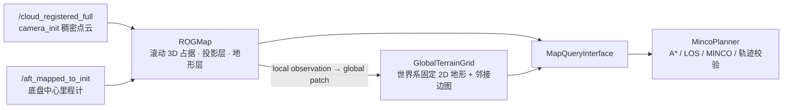
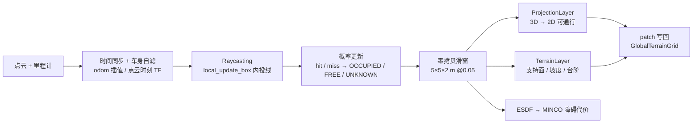
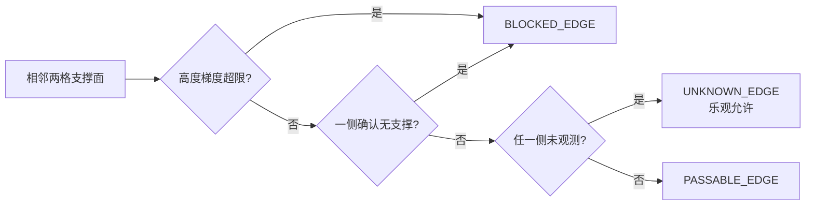

ROGMap 是嵌在 `MincoPlanner` 里的**进程内滚动占据地图**：它把 Point-LIO 的稠密世界系点云维护成三维概率占据、二维投影/地形层和世界系固定的全局地形图，并通过 `MapQueryInterface` 供规划器直接查询，不经过 ROS topic。

## 1. 在链路中的位置



- 单进程、零序列化：`MincoPlanner` 在 configure 阶段创建地图实例并持有查询指针，规划搜索、优化与安全检查直接读内存地图。
- 地图仍通过 ROS 2 收点云与里程计、发布可视化；**没有独立的地图节点和 launch**。
- 全链路唯一 TF 发布者是 Point-LIO：世界系 `camera_init`，底盘中心 `base_link`。

## 2. 启动与检查

ROGMap 随 `planner_server` 中的 `MincoPlanner` 一起创建：

```bash
bash launch.sh                                   # 或 ros2 launch navigation online_navigation.launch.py
ros2 topic hz /cloud_registered_full             # 输入点云（test2 bag 约 10 Hz）
ros2 topic hz /rog_map/occupied                  # 可视化只在有订阅者时计算与发布
ros2 param list /planner_server | grep rog_map
```

## 3. 参数配置入口

| 位置 | 负责范围 |
| --- | --- |
| `src/navigation/params/online_planner.yaml` → `MincoPlanner.rog_map.*` | 地图几何与滑窗、点云回调与时间同步、车身自滤、raycast 与概率更新、投影/地形层、全局地形图、ESDF、可视化 |
| `src/point_lio/config/mapping/mid360.yaml` → `robot_extrinsic` | 雷达—底盘外参（**唯一来源**）；launch 读取后注入 ROGMap 射线原点，并校验 frame 一致 |

改外参或 frame 名后必须重启全部窗口。

## 4. 技术路线

### 4.1 更新主链



- 回调只做「保存最新一帧 + notify」，**latest-only**：处理期间到达的新点云直接覆盖旧的，不排队积压。
- 每帧只处理 `ros_callback.update_period_ms`（当前 15 ms，66 Hz 轮询）内的最新帧。
- 障碍清除只有一个来源：后续 ray miss 或再次确认为 free；没有新观测不会清障，也不做全图 flood fill。

### 4.2 地图层语义

| 层 | 作用 |
| --- | --- |
| Occupancy | 三维 free / occupied / unknown 概率状态 |
| Inflated Occupancy | 按机器人安全尺度膨胀后的障碍状态 |
| Projection Layer | 单柱投影得到的 FREE / PASSABLE / OCCUPIED / UNKNOWN |
| Terrain Layer | 支持面高度、坡度、台阶与无支撑证据 |
| GlobalTerrainGrid | 世界系固定的二维地形 + 邻接边状态（planner 的唯一查询对象） |
| ESDF | 到最近障碍的有符号距离与梯度 |

投影层不是「取最高点」：它统计指定 Z 范围内的观测体素数、占据高度跨度、垂直占据率，并叠加墙面/隧道判据与迟滞。当前实现是**单柱高度统计分类，不是坡面分割或地面模型拟合**。

### 4.3 世界系全局地形图与边状态

滚动窗口只负责机器人附近的观测，planner 统一查世界系固定的 `GlobalTerrainGrid`；历史区域不随机器人移动消失，但仍可被新观测修正。相邻支撑格的高度关系决定边状态（`slope_max_deg=35°`）：



统一查询语义：`cellTraversable`（UNKNOWN/FREE→true，OCCUPIED→false）、`edgeAllowed`（UNKNOWN_EDGE/PASSABLE_EDGE→true，BLOCKED_EDGE→false）、`footprintFree`（足印圆内同时检查障碍格与 BLOCKED 边）。

> 当前 `void_gain=0.0`，即「一侧确认无支撑」的多帧证据链关闭；`global_map.enable=false` 可一键回退到旧的滚动局部图行为。

### 4.4 实时性要点（test2 bag 实测）

- 10 Hz 点云输入下地图稳定 **~9.8 Hz**，`cloud_callback_hz == map_update_hz`，不丢帧。
- 单帧地图处理约 **28 ms**：其中 raycast + 概率更新 ~21 ms（每帧 ~86k cache voxel / ~420k ray step），ProjectionLayer ~6.4 ms。
- dirty 列占比在本配置下约 78% > `dirty_full_ratio`，因此投影实际每帧走**全量刷新**；这是当前的主要优化边界。
- 并行 raycast 实测**更慢**（merge/sort ~420k 射线），保持 `parallel_enable: false`。
- 局部 ESDF 按 `field.update_rate`（10 Hz）限频，不再每帧重建。

## 5. 目录架构

```text
src/rog_map/
├── include/rog_map/            # 地图核心与稳定查询接口
│   ├── map_query_interface.hpp     # planner 依赖的 public API
│   ├── projection_layer.hpp /      # 二维投影分类
│   ├── terrain_layer.hpp /         # 支持面、坡度、台阶
│   ├── global_terrain_grid.hpp /   # 世界系固定二维地形（planner 唯一查询对象）
│   ├── field_layer.hpp / esdf_map.h / prob_map.h / rog_map.h
│   └── rog_map_core/               # 滑窗、计数器图、raycaster、配置
├── include/rog_map_ros/        # ROS 2 外壳
│   ├── rog_map_ros2.hpp            # 回调、QoS、时间同步、可视化
│   ├── callback_gate.hpp           # 回调生命周期
│   ├── odometry_buffer.hpp         # 里程计插值缓冲
│   └── cloud_registered_crop_filter.hpp
├── include/super_utils/        # 颜色文本、Eigen 别名、计时等头文件工具
├── src/rog_map/                # 上述核心的实现
├── src/rog_map_ros/            # cloud_registered_crop_filter.cpp
└── test/                       # gtest + map_pipeline_diagnostic
```

`grid_map_core` 是本包的编译依赖，为 `GlobalTerrainGrid` 提供 `grid_map::GridMap` 容器；反过来 `grid_map_core` 不依赖 rog_map。

## 6. Reference

**上游算法与工程**

- ROG-Map — [hku-mars/ROG-Map](https://github.com/hku-mars/ROG-Map)，[arXiv:2302.14819](https://arxiv.org/abs/2302.14819)：滚动占据栅格建图。
- grid_map — [ANYbotics/grid_map](https://github.com/ANYbotics/grid_map)：`GlobalTerrainGrid` 的底层容器。
- Point-LIO — [hku-mars/Point-LIO](https://github.com/hku-mars/Point-LIO)：稠密世界系点云与里程计来源。

**仓库内文档**

- [工作区主页](../../README.md)
- [navigation/README.md](../navigation/README.md)：A* / LOS / MINCO / 轨迹校验如何查询地图
- [point_lio/README.md](../point_lio/README.md)：点云与里程计的产出
